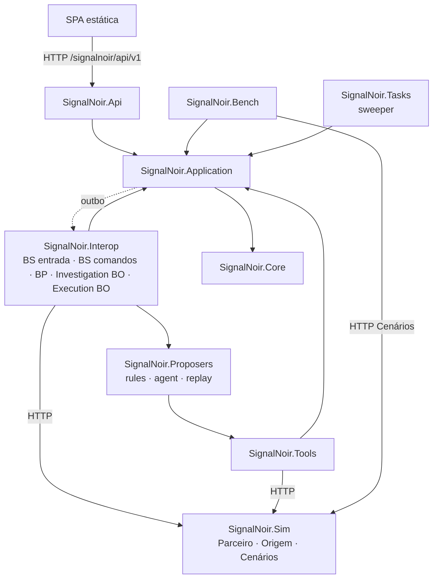
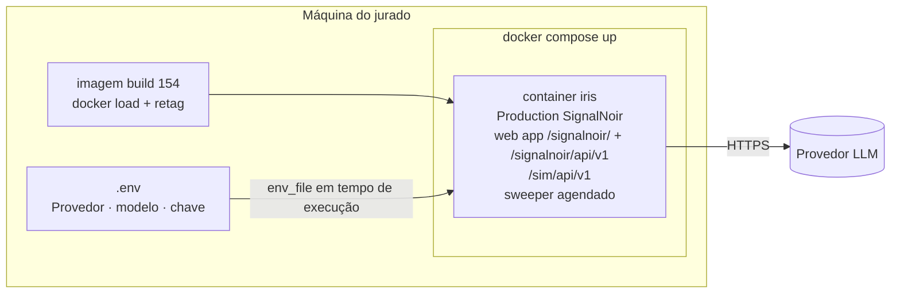
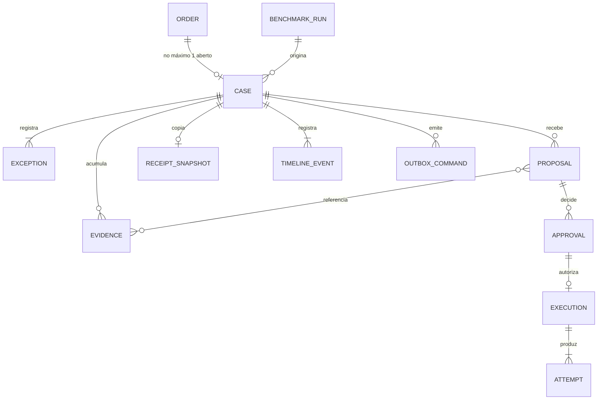

# Architecture Spine — Signal Noir

## Design Paradigm

**Hexagonal (ports and adapters).**

| Pacote | Papel |
|---|---|
| `SignalNoir.Core` | Domínio puro, sem I/O: agregados Order e Case, máquina de estados, tabela de atores, Validador, canonização da Chave de Equivalência, classificador de respostas do Parceiro, derivação da Chave de Idempotência, vocabulário de pré-condições e de comandos. |
| `SignalNoir.Application` | Comandos e consultas: o único caminho de mutação (AD-2) e o outbox (AD-20). |
| `SignalNoir.Interop` | Production: BS de entrada e de comandos, BP, BO de investigação, Execution BO. |
| `SignalNoir.Api` | API REST. |
| `SignalNoir.Proposers` | Implementações da porta de proposição: `rules`, `agent`, `replay`. |
| `SignalNoir.Tools` | Porta de Ferramentas. |
| `SignalNoir.Tasks` | Sweeper. |
| `SignalNoir.Bench` | Executor do Benchmark. |
| `SignalNoir.Sim` | Bounded context externo, alcançado só por HTTP. |



**Direção de dependência:**
- `Core` não depende de nada; `Application` depende só de `Core`.
- `Proposers` e `Tools` dependem de `Application` e `Core`.
- Nenhum pacote referencia classes de `SignalNoir.Sim`; com ele, a conversa é só por HTTP.

## Invariants & Rules

### AD-1 — Núcleo puro, Production como casca [ADOPTED]
- **Binds:** all
- **Prevents:** regras de estado e validação espalhadas em BS/BP/BO; Modo Regras e Agente validados por código diferente.
- **Rule:**
  - Ficam só em `SignalNoir.Core`, sem I/O:
    - máquina de estados;
    - tabela de atores (AD-24);
    - Validador;
    - canonização da Chave de Equivalência;
    - classificador de respostas do Parceiro;
    - derivação da Chave de Idempotência;
    - vocabulários fechados (pré-condições, comandos, códigos de erro).
  - Os demais pacotes chamam essas funções e não as reimplementam.

### AD-2 — Caminho único de mutação: comandos de transição e de anexação [ADOPTED]
- **Binds:** FR-3 a FR-8, FR-17 a FR-24, FR-29, FR-47, FR-51
- **Prevents:** escritores gravando direto no Caso; eventos sem registro; `caseVersion` mudando sem transição; transação longa segurando I/O.
- **Rule:**
  - Order, Case e suas entidades filhas só mudam por comandos de `SignalNoir.Application`, que são de dois tipos:
    - **Comando de transição.** Muda o estado e incrementa `caseVersion`. Grava, na mesma transação, o novo estado, o evento da Linha do Tempo e as entradas de outbox (AD-20).
    - **Comando de anexação.** Não muda o estado nem incrementa `caseVersion`. Grava Evidências, chamadas de Ferramenta, vereditos do Validador, resultados de Revalidação e Reconciliação, Exceções recebidas durante a Execução e anotações. Cada um recebe `seq` por `$INCREMENT` e atualiza `lastEventAt`.
  - Toda transação é curta e **sem I/O** (HTTP, LLM, envio a BS).
  - Passos com I/O seguem sempre o padrão: CAS de entrada, I/O fora da transação, CAS de saída ou anexação.

### AD-3 — Concorrência otimista por compare-and-swap [ADOPTED]
- **Binds:** Api, Interop, Bench, Tasks
- **Prevents:** duas Aprovações efetivas; Reavaliação atropelando uma Aprovação; escritor que vence sem perceber o conflito.
- **Rule:**
  - Toda transição grava só se `caseVersion`, o estado esperado e o identificador alvo (`proposalId` ou `executionId`) ainda forem os lidos. Não há lock pessimista.
  - Comandos de anexação não usam CAS de versão. Eles só exigem que o Caso esteja num estado que aceita aquela anexação.
  - Em conflito:
    - **API:** devolve HTTP 409 `STALE_VERSION`.
    - **Exceção, Aprovação repetida:** se a mesma `proposalId` já estiver aprovada, devolve sucesso idempotente com a Aprovação existente.
    - **Sweeper:** registra que pulou o Caso e segue.
    - **Jobs internos:** fazem 1 retry curto e depois registram a falha.
    - **Bench:** CAS perdido em leitura não conta como falha de variante.

### AD-4 — O Caso é a fonte de verdade; a Production guarda só transporte [ADOPTED]
- **Binds:** FR-4, Interop, Tasks
- **Prevents:** Production agindo sobre decisão vencida após reinício; dois donos do mesmo estado.
- **Rule:**
  - O Caso persistido é a verdade sobre a resolução. Mensagens e sessões da Production são estado de transporte.
  - Nenhum BP ou BO dá um passo sem reler o Caso e conferir estado, `caseVersion` e autorização contra o `caseVersionAfter` do comando que recebeu.
  - Comando com versão vencida é descartado e registrado. Em divergência, prevalece o Caso.

### AD-5 — Caminho único de Execução, só no Execution BO [ADOPTED]
- **Binds:** FR-16, FR-19 a FR-23, NFR-6, Api, Bench, Tasks
- **Prevents:** dois clientes do Parceiro; atalho do Benchmark; Execução dupla por comando repetido; efeito sem autorização registrada.
- **Rule:** todo efeito externo acontece só no Execution BO, nesta ordem:
  1. **CAS de autorização.** `Approved → Executing` cria a `Execution` com sua Chave de Idempotência (AD-21) e o lease (AD-22). Só o vencedor desse CAS segue.
  2. **Revalidação** das pré-condições (AD-26), feita imediatamente antes do efeito. Se falhar, o BO faz a transição para `Held` ou `Cancelled`.
  3. **Reconciliação prévia.** O BO consulta os Recibos do Parceiro por `orderId` antes de qualquer envio. Se já houver entrega, vai para `Resolved` sem enviar.
  4. **Envio** com a Chave de Idempotência.
  5. **Classificação da resposta** pelo Core (AD-13). Resposta `uncertain` ou timeout dispara a Reconciliação.

  Aprovação humana, Aprovação Automática de Benchmark e Reavaliação só alimentam esse caminho. Tentativas da Política dentro do BO são `Attempt` da `Execution`, nunca `Exception` do Caso.

### AD-6 — Comandos entram na Production por um único Business Service [ADOPTED]
- **Binds:** Api, Bench, Tasks, Interop
- **Prevents:** cada adaptador acordando o BP do seu jeito; comandos fora do Visual Trace.
- **Rule:**
  - Comandos do outbox (AD-20) são entregues a um único Business Service de comandos, que os roteia ao BP. Nada chama BP ou BO diretamente.
  - Os tipos de comando são um enum do Core: `Investigate`, `Execute`, `Reconcile`, `Expire`, `Reassess`, `Resume`.

### AD-7 — Reavaliação reabre antes da decisão [ADOPTED]
- **Binds:** FR-51, Tasks
- **Prevents:** execução ressuscitada com decisão velha.
- **Rule:** `Held` → Reavaliação → `Investigating` → nova Proposta → Validador → `PendingApproval`. Aprovação anterior nunca é reaproveitada depois de `Held`.

### AD-8 — Um único sweeper sem efeitos externos [ADOPTED]
- **Binds:** FR-4, FR-18, FR-51, Tasks
- **Prevents:** dois jobs disputando o mesmo Caso; vários relógios; efeito fora do AD-5.
- **Rule:**
  - Há uma única tarefa agendada do IRIS (`%SYS.Task.Definition`). A cada execução ela faz três passadas:
    1. reenvio de entradas pendentes do outbox;
    2. expiração de Aprovações e Reavaliação de `Held`;
    3. Casos com lease vencido (AD-22).
  - Ela só emite comandos de transição permitidos ao ator `sweeper` (AD-24) e entradas de outbox. Nenhum outro componente tem timer.

### AD-9 — Porta única de proposição, cega à origem [ADOPTED]
- **Binds:** FR-9, FR-12, FR-39, FR-41, FR-48, FR-53, Interop, Proposers, Bench
- **Prevents:** placar comparando implementações em vez de decisões; fluxo tratando Propostas de forma diferente conforme o autor.
- **Rule:**
  - O BO de investigação coleta o pacote base de Evidências pela porta de Ferramentas. Em seguida chama a implementação de `SignalNoir.Proposers` indicada no Caso:
    - `agent` é o padrão;
    - `rules` e `replay` só são usados quando o Caso pertence a um BenchmarkRun (AD-23).
  - Todas as implementações devolvem o mesmo DTO de Proposta. Cada Proposta é imutável e tem `proposalId` próprio.
  - Depois da porta, nenhum componente lê o modo para decidir comportamento.

### AD-10 — Ferramentas só pela porta de Ferramentas, sempre como Evidência [ADOPTED]
- **Binds:** FR-10, FR-11, FR-13, FR-53, NFR-1, Tools
- **Prevents:** Agente e Modo Regras consultando fontes diferentes; chamadas sem registro; orçamento apenas "pedido no prompt".
- **Rule:**
  - Toda consulta de qualquer propositor passa por `SignalNoir.Tools`, inclusive o pacote base e as chamadas adicionais.
  - A porta é somente leitura e aplica o orçamento do NFR-1 por contagem e tempo.
  - Cada chamada é gravada como Evidência (comando de anexação) antes de retornar ao propositor.
  - Os `%AI.ToolSet` do Agente apontam só para métodos dessa porta.
  - Conteúdo de Pedido, Parceiro ou log é tratado como dado; trechos suspeitos são marcados na Evidência.

### AD-11 — O Agente só é chamado pelo propositor `agent` e não escreve [ADOPTED]
- **Binds:** FR-9, FR-12, FR-13, FR-50, Proposers
- **Prevents:** Agente invocado de vários lugares com sessões e versões diferentes; Agente alterando estado.
- **Rule:**
  - Só o propositor `agent`, executado dentro do BO de investigação, instancia a classe `%AI.Agent`, com uma sessão nova por Investigação.
  - A saída do Agente é dado. Ela só vira Proposta depois de convertida no DTO e aprovada pelo Validador.
  - A Proposta registra Provedor, modelo, versão do prompt e tokens.
  - Resposta inválida, recusa, timeout ou Provedor indisponível levam o Caso a `ReviewRequired`.

### AD-12 — Validador determinístico e puro para toda Proposta e todo encerramento [ADOPTED]
- **Binds:** FR-14, FR-15, FR-16, FR-24, FR-29, FR-47
- **Prevents:** encerramento por inferência do Agente; Propostas do Operador ou do Modo Regras escapando das regras; o Validador fazendo I/O.
- **Rule:**
  - Toda Proposta (agent, rules, replay ou operador) passa pelo Validador do Core antes de Aprovação ou Execução. O Validador recebe tudo como parâmetro e não faz I/O.
  - `ResolvedByPriorReceipt` só ocorre depois de duas etapas:
    1. a Application obtém do Parceiro, via Ferramentas, o Recibo e o snapshot bruto do Pedido associado;
    2. o Validador confirma que as Chaves de Equivalência canonizadas pelo Core (AD-25) coincidem.
  - A resolução pelo Operador (FR-29) é um comando único: cria a Proposta (autor `operator:<nome>`), valida e registra a Aprovação do mesmo Operador. Se o Validador recusar, nada é gravado além do veredito.

### AD-13 — Simulador como sistema externo, só por HTTP, com contrato normativo [ADOPTED]
- **Binds:** FR-2, FR-10, FR-20, FR-23, FR-30 a FR-33, FR-39, FR-40, Sim, Tools, Interop, Bench
- **Prevents:** atalhos em processo; classificação de resposta divergente entre frentes; contaminação entre variantes e repetições.
- **Rule:** `SignalNoir.Sim` só é alcançado por HTTP, e o contrato (AD-16) fixa:
  1. **Respostas do Parceiro.** O Core classifica `{status, body}` em `success`, `business_error`, `transient` ou `uncertain`. `uncertain` inclui timeout, 5xx sem corpo e 200 sem Recibo válido, e sempre leva à Reconciliação.
  2. **Duplicata.** A mesma `idempotencyKey` com o mesmo payload devolve o Recibo original. A mesma chave com payload diferente devolve 422.
  3. **Consulta de Recibos.** `GET` por `idempotencyKey`, por `orderId` e por paciente sintético. A resposta traz os campos do AD-14 e o snapshot bruto do Pedido associado, sem chave pronta.
  4. **Cenários por instância.** `POST /sim/api/v1/scenarios` cria um `scenarioInstanceId`. A Origem simulada emite Pedidos já ligados a ele, e Parceiro, saúde, logs e status respondem conforme essa instância. Não existe "cenário ativo" global.
  5. **Namespace de IDs.** `orderId` emitidos pela Origem simulada são únicos por `scenarioInstanceId` e repetição. Nunca se repetem entre execuções.

### AD-14 — Recibo canônico no Parceiro, cópia auditável no Caso [ADOPTED]
- **Binds:** FR-2, FR-22, FR-23, FR-24, FR-47
- **Prevents:** dois registros de Recibo divergentes sem desempate.
- **Rule:**
  - O Recibo canônico pertence ao Parceiro Simulado.
  - O Caso guarda uma cópia auditável (`receiptId`, `orderId`, `idempotencyKey`, momento, parceiro, snapshot mínimo) com a referência externa.
  - Em divergência, prevalece o Parceiro. Em Caso não terminal, a correção é feita por comando. Em Caso terminal, entra só uma anotação, sem mudar o estado.

### AD-15 — Visual Trace para o fluxo principal, Linha do Tempo para a investigação [ADOPTED]
- **Binds:** FR-7, FR-9, FR-35, FR-37, NFR-9
- **Prevents:** exigir que Ferramentas virem mensagens da Production, quando elas rodam dentro do `Chat()` síncrono do Agente.
- **Rule:**
  - São mensagens da Production, visíveis no Visual Trace:
    - entrada do Pedido;
    - comandos;
    - chamada ao Agente;
    - Proposta;
    - Execução;
    - chamada ao Parceiro;
    - Recibo e Reconciliação.
  - As chamadas de Ferramenta são garantidas como Evidência e evento da Linha do Tempo (AD-10).

### AD-16 — HTTP contract-first; interno code-first [ADOPTED]
- **Binds:** Api, Sim, UI, Interop, Tools, Bench
- **Prevents:** interface e Simulador vazando o modelo interno; frentes integrando contra suposições.
- **Rule:**
  - Toda interface HTTP tem um OpenAPI versionado em `contracts/` como fonte da verdade: `/signalnoir/api/v1` e `/sim/api/v1`.
  - Mudança de contrato vem antes da mudança de código.
  - Contratos internos em ObjectScript são DTOs explícitos.

### AD-17 — Interface estática no IRIS, hash routing, polling incremental [ADOPTED]
- **Binds:** FR-34 a FR-38, UI, Api
- **Prevents:** container extra; deep links quebrados; dependência de conexão longa; cursor perdendo anexações.
- **Rule:**
  - A SPA é compilada para estático, com caminhos de assets relativos, e servida por uma web application do IRIS em `/signalnoir/`.
  - O roteamento é por hash (`#/…`).
  - O polling roda a cada 1–2 s:
    - a lista usa cursor sobre `(lastEventAt, caseId)`;
    - a Linha do Tempo é paginada por `sinceSeq`;
    - toda resposta traz `caseVersion`, `lastEventSeq` e `serverTime`.

### AD-18 — Segredos entram por `.env` em tempo de execução e viram configuração do AI Hub [ADOPTED]
- **Binds:** FR-44, FR-50, NFR-8, Interop
- **Prevents:** chave embutida na imagem; chave lida por variável de ambiente em job de background (issue #31); chave persistida em dados.
- **Rule:**
  - O compose injeta `.env` só em tempo de execução (`env_file`). A imagem nunca contém segredo.
  - O bootstrap de inicialização (AD-27) grava, de forma idempotente, Provedor, modelo e chave na configuração do AI Hub: Config Store com `RebuildRegistry`, ou `%AI.Provider.Create` como fallback.
  - A chave nunca aparece em Caso, Evidência, log, export ou repositório.

### AD-19 — Aprovação Automática de Benchmark emitida só pelo BP [ADOPTED]
- **Binds:** FR-16, FR-39 a FR-41, FR-48, FR-49, Interop, Bench
- **Prevents:** Bench e BP aprovando o mesmo Caso; Aprovação automática vazando para a operação normal; Replay contado como execução real.
- **Rule:**
  - Quando o Validador exige Aprovação num Caso de BenchmarkRun (AD-23), o BP emite, no mesmo passo, o comando de Aprovação com ator `benchmark`.
  - O Bench nunca aprova; ele só cria o BenchmarkRun, dispara os Cenários e observa.
  - Fora de BenchmarkRun, o Core recusa o ator `benchmark`.
  - Casos com `replay = true` ficam fora das métricas.

### AD-20 — Outbox de comandos na mesma transação da transição [ADOPTED]
- **Binds:** Application, Api, Bench, Tasks, Interop
- **Prevents:** Caso em `Approved` com o comando perdido; BP relendo o Caso antes do commit; comando duplicado executado duas vezes.
- **Rule:**
  - Toda transição que exige trabalho da Production grava na mesma transação uma entrada de outbox com:
    - `commandId`;
    - tipo (AD-6);
    - `caseId`;
    - `caseVersionAfter`.
  - Depois do commit, quem fez a transição despacha a entrada ao BS de comandos. O sweeper redespacha as que ficaram pendentes.
  - O BP processa cada `commandId` no máximo uma vez e confere `caseVersionAfter` contra o Caso (AD-4).

### AD-21 — Derivação da Chave de Idempotência [ADOPTED]
- **Binds:** FR-19, FR-22, FR-23, NFR-6, Core, Interop, Sim
- **Prevents:** chave diferente para a mesma autorização; chave igual para Mapeamentos diferentes.
- **Rule:**
  - `idempotencyKey = H(orderId, action, params canônicos, proposalId)`, calculada só pelo Core no CAS de autorização (AD-5, passo 1).
  - A mesma Proposta aprovada gera sempre a mesma chave.
  - Mudança de Ação ou de parâmetros só acontece por nova Proposta, e a duplicidade entre Propostas diferentes é barrada pela Reconciliação prévia por `orderId` (AD-5, passo 3).

### AD-22 — Lease de etapa e ordem de timeouts [ADOPTED]
- **Binds:** FR-4, FR-23, Interop, Tasks
- **Prevents:** sweeper "resgatando" um Caso em voo; BO perdendo o CAS com o Recibo na mão e descartando o efeito.
- **Rule:**
  - Os CAS de entrada em `Investigating` e `Executing` gravam `stepLeaseUntil`.
  - O sweeper só age depois do lease:
    - em `Executing`, emite `Reconcile`, nunca `ReviewRequired` direto;
    - em `Investigating`, leva o Caso a `ReviewRequired` (FR-4).
  - Quem perde um CAS depois de produzir efeito externo emite `Reconcile`.
  - Na inicialização, o bootstrap verifica que lease > timeout HTTP do Parceiro + orçamento da Investigação (NFR-1). Se a desigualdade não valer, a Production não sobe.

### AD-23 — Proveniência do Benchmark por BenchmarkRun [ADOPTED]
- **Binds:** FR-39 a FR-41, FR-48, Bench, Interop, Proposers
- **Prevents:** `benchmarkMode` sem origem segura, já que quem cria o Caso é a Production; modo `rules` ou `replay` vazando para a operação.
- **Rule:**
  - O Bench cria um `BenchmarkRun` via Application, com `runId`, modo (`rules`, `agent` ou `replay`), Provedor, modelo e Cenários.
  - O Pedido traz só o `runId` no envelope do Simulador.
  - Ao abrir o Caso, a Application copia o modo e as flags do BenchmarkRun ativo. Sem `runId` válido, o modo é `agent` e não há flags.

### AD-24 — Tabela transição → ator autorizado [ADOPTED]
- **Binds:** Core, Application, Api, Interop, Tasks
- **Prevents:** duas unidades donas da mesma transição (expiração, Held, Rejected); nova Exceção arrancando um Caso em execução.
- **Rule:**
  - O Core mantém a tabela de transições com o ator autorizado de cada uma. Cada comando declara seu ator, e um ator não listado recebe `INVALID_ACTOR`.
  - **Substituída em 2026-10-22:** a tabela "Pontos fixados" abaixo fica só como histórico. A fonte normativa das transições e dos atores é `contracts/case-state-machine.yaml`, legível em `specs/001-case-state-machine/spec.md`. A regra acima (o Core mantém a tabela e recusa ator não listado com `INVALID_ACTOR`) continua valendo.
  - Pontos fixados (histórico):

    | Transição ou regra | Ator autorizado |
    |---|---|
    | Expiração de Aprovação | só o sweeper. Ao detectar a expiração, o Execution BO recusa e emite `Expire`. |
    | `Rejected → Investigating` | o BP, por comando |
    | Contador de negações (FR-5) | o agregado |
    | Nova Exceção em `Approved` ou `Executing` | é anexação e não transição; é reavaliada quando a Execução termina (`Failed` → `Investigating`) |

### AD-25 — Pedido como agregado próprio e Chave de Equivalência canônica [ADOPTED]
- **Binds:** FR-1, FR-3, FR-24, FR-47, Core, Application, Interop
- **Prevents:** chave canonizada em dois lugares; mais de um Caso aberto por `orderId`; P9 sem fonte.
- **Rule:**
  - O BS de entrada cria um agregado Order via Application, com snapshot imutável e Chave de Equivalência canonizada só pelo Core:
    - códigos ordenados;
    - UTC;
    - caixa normalizada.
  - A chave fica indexada.
  - Um índice único garante no máximo um Caso não terminal por `orderId`.
  - O Simulador nunca devolve chave pronta.

### AD-26 — Dados de referência versionados e vocabulário fechado de pré-condições [ADOPTED]
- **Binds:** FR-10, FR-12, FR-14, FR-15, FR-18, FR-20, Core, Application, Tools, Bench
- **Prevents:** Políticas e Catálogo de Mapeamentos sem dono; Revalidação e expiração não determinísticas.
- **Rule:**
  - Políticas e Catálogo de Mapeamentos são dados de referência do produto, de propriedade da Application. São versionados (`policyVersion`, `mappingVersion`) e carregados de arquivos de fixture versionados no repositório.
  - Um BenchmarkRun pode fixar o conjunto de fixtures. O Simulador não os possui.
  - As pré-condições de uma Proposta usam só o vocabulário do Core:
    - `PARTNER_HEALTHY_WINDOW`
    - `ORDER_ACTIVE_AT_ORIGIN`
    - `APPROVAL_VALID`
    - `POLICY_VERSION_UNCHANGED`
    - `MAPPING_VERSION_UNCHANGED`
  - Revalidação e expiração (FR-18) avaliam esses checks e nada além deles.

### AD-27 — Starter ratificado e bootstrap em dois tempos [ADOPTED]
- **Binds:** FR-42, FR-43, FR-44, NFR-5, NFR-10, NFR-11, repositório
- **Prevents:** segredo na imagem; dependência de `wget` ou ZPM ausente no build 154; estático escondido por bind mount; ambiguidade sobre o que sobrevive a reinício.
- **Rule:**
  - **Starter.** O starter é o `intersystems-iris-dev-template` existente, adaptado. A base do Dockerfile é a imagem local do build 154 retagueada, com tag fixada no compose.
  - **Build.** Instala o IPM pinado pelo instalador via `%Net.HttpRequest` (alias `installipm` do `.iris_init`), carrega o módulo e compila. Não usa segredos.
  - **Start.** `env_file`, seguido do bootstrap idempotente de inicialização (`%ZSTART` chamando um método de `SignalNoir.Interop`). O bootstrap materializa a configuração do AI Hub (AD-18), verifica os timeouts (AD-22), garante a Production e o agendamento do sweeper e carrega as fixtures (AD-26).
  - **Compose da submissão.** Não monta o repositório como volume e usa portas de host fixas. Um compose de desenvolvimento separado (`docker-compose.dev.yml`, nunca carregado automaticamente) pode montar o repositório.
  - **Durabilidade.** Os dados sobrevivem a `docker compose restart` e a `stop`/`start` (FR-4). `docker compose down` recria o estado da demo, e o README declara isso.

### AD-28 — CI sem publicação de imagem [ADOPTED]
- **Binds:** FR-42, edital (proibição de registry público), `.github/workflows`
- **Prevents:** publicar imagem derivada do AI Hub em registry público (`github-registry.yml` publica no ghcr.io; `build-push-gcr.yaml` faz deploy no Cloud Run).
- **Rule:**
  - Nenhum workflow publica, empurra ou implanta imagem. `github-registry.yml` e `build-push-gcr.yaml` são removidos.
  - A CI se limita a análise estática (`objectscript-quality.yml`) e, se viável numa imagem IRIS pública, aos `%UnitTest` do Core, que não dependem do AI Hub.

## Consistency Conventions

| Concern | Convention |
| --- | --- |
| Termos | Glossário do PRD em inglês no código: `Order`, `Case`, `Proposal`, `Evidence`, `Approval`, `Execution`, `Attempt`, `Receipt`, `Exception`, `BenchmarkRun`. Estados e Ações exatamente como no PRD. |
| Pacotes | Os do Design Paradigm. Testes em `SignalNoir.Tests.<Pacote>`. |
| IDs | Strings opacas com prefixo: `case_`, `prop_`, `appr_`, `exec_`, `evid_`, `cmd_`, `run_`. `orderId` vem do Pedido; `receiptId` vem do Parceiro. |
| Datas | ISO-8601 UTC com `Z` em API, Evidência, Linha do Tempo e export. Conversão para BRT só na interface. |
| Erros HTTP | Envelope `{ "error": { "code", "message", "details" } }`. Códigos do enum do Core: `STALE_VERSION`, `INVALID_TRANSITION`, `INVALID_ACTOR`, `VALIDATION_FAILED`, `NOT_FOUND`. 409 para versão ou estado. |
| Linha do Tempo | Evento `{seq, at, type, actor, refId, payload}`. `seq` monotônico por Caso, via `$INCREMENT`. Ator ∈ `system`, `agent`, `rules`, `replay`, `operator:<nome>`, `benchmark`, `sweeper`. |
| Rótulos | `synthetic` e `replay` em todo Caso e export (FR-38). |
| Configuração | Variáveis de ambiente lidas só pelo bootstrap de inicialização. Nenhum valor de ambiente vai para classe, global de código ou imagem. |
| Logs | Erros técnicos no log do IRIS/Production. Fatos de negócio só na Linha do Tempo. Nunca registrar chave nem payload completo do Provedor. |
| Testes | `%UnitTest` cobre o Core: estados, atores, Validador, Chave de Equivalência, classificador, idempotência, CAS. O Benchmark é o teste de integração. A validação rápida (FR-49) é o smoke test. |

## Stack

| Name | Version |
| --- | --- |
| InterSystems IRIS Community com AI Hub (EAP) | 2026.3.0AI.154.0 (x64 e ARM64, via `docker load` e retag) |
| ObjectScript `%AI.Agent`, `%AI.ToolSet`, `%AI.Provider` | build 154 |
| IPM | 0.10.10 |
| Svelte | 5.57.2 |
| SvelteKit + @sveltejs/adapter-static | 3.1.0 + 4.0.0 |
| Vite | 8.3.4 |
| Node.js (só no estágio de build da SPA) | 24.22.0 LTS |
| Docker Compose (plugin `docker compose`) | 5.6.0 |

## Structural Seed

**Implantação (um runtime).**



- **Imagem.** Build multi-stage: Node 24 compila a SPA, e o estágio final, sobre a imagem local retagueada, instala o IPM, carrega o módulo e copia o estático. Exige o builder padrão `docker`, porque o driver `docker-container` não enxerga imagens locais. O README declara isso.
- **Rede.** O Simulador fica no mesmo container, mas só é chamado por HTTP (AD-13).
- **Ambientes.** Só o local, igual para desenvolvimento, jurado e demo. Não há registry (AD-28).

**Entidades centrais.**



**Árvore mínima.**

```text
src/SignalNoir/
  Core/  Application/  Interop/  Proposers/  Tools/  Api/  Tasks/  Bench/  Sim/
tests/SignalNoir/Tests/
ui/                  # SPA Svelte → estático
contracts/           # openapi-signalnoir.yaml, openapi-sim.yaml
fixtures/            # políticas, mapeamentos, cenários (versionados)
docker-compose.yml   # submissão
docker-compose.dev.yml
```

## Capability → Architecture Map

| Capability / Area | Lives in | Governed by |
| --- | --- | --- |
| FR-1 a FR-4: entrada, entrega, abertura e retomada | Interop + Application | AD-2, AD-4, AD-5, AD-20, AD-22, AD-25 |
| FR-5 a FR-8: estados, camadas, Linha do Tempo, projeções | Core + Application | AD-1, AD-2, AD-3, AD-24 |
| FR-9 a FR-13, FR-50, FR-53: Investigação, Agente, Ferramentas, Provedor | Interop + Proposers + Tools | AD-9, AD-10, AD-11, AD-15, AD-18 |
| FR-14 a FR-16, FR-47: Validador, Política de Aprovação, Recibo anterior | Core | AD-12, AD-19, AD-25, AD-26 |
| FR-17 a FR-19: Aprovação | Api → Application | AD-3, AD-20, AD-24 |
| FR-20 a FR-24: Revalidação, Execução, idempotência, Reconciliação | Interop (Execution BO) | AD-5, AD-13, AD-14, AD-21, AD-22, AD-26 |
| FR-51: Reavaliação | Tasks | AD-7, AD-8, AD-24 |
| FR-28, FR-29: Dossiê e resolução pelo Operador | Core + Api + UI | AD-2, AD-12 |
| FR-30 a FR-33: Simulador e Cenários | Sim | AD-13, AD-16 |
| FR-34 a FR-38: interface | UI + Api | AD-16, AD-17 |
| FR-39 a FR-41, FR-48, FR-49: Benchmark, Modo Regras, Replay, validação | Bench + Proposers | AD-9, AD-19, AD-23 |
| FR-42 a FR-46, FR-52: pacote de submissão | repositório, Dockerfile, compose, README | AD-27, AD-28 |
| NFR-1: orçamento | Tools | AD-10, AD-22 |
| NFR-2, NFR-3, NFR-4, NFR-9: latência, custo, observabilidade | Proposers + Bench | AD-11, AD-15 |
| NFR-5, NFR-6, NFR-7, NFR-8: durabilidade, duplicidade, segurança, fail-safe | Core + Interop | AD-2, AD-5, AD-12, AD-21, AD-27 |
| NFR-10, NFR-11: instalação e plataformas | repositório | AD-27, AD-28 |

## Deferred

- **Incidentes, Escopo `batch`, P2:** fora da submissão. O DTO mantém `scope` com valor único `single_case`.
- **Fases:** fora. Exceções do mesmo Pedido ficam no Caso (AD-24).
- **Autenticação:** fora. O Operador se identifica pelo nome.
- **SSE:** só entra se o polling se mostrar insuficiente e o build 154 sustentar conexão longa.
- **Ferramentas como mensagens da Production via BO:** experimento do spike (AD-15).
- **Mecanismo do CAS** (`VERSIONPROPERTY` ou `UPDATE` condicional): escolha do build, sob o AD-3.
- **Formato interno de mensagens e DTOs:** definido pelo código, sob AD-6, AD-9 e AD-20.
- **Portas de host, valor do lease e timeouts concretos:** definidos no build, sob a desigualdade do AD-22, e documentados no README.
- **System 1, HL7/FHIR, MCP, múltiplos Provedores simultâneos, multi-container:** fora da v1.
- **Observabilidade além do Visual Trace, da Linha do Tempo e do relatório do Benchmark:** adiada.

**Questões em aberto (spike de 25/10, responsável José):**
- **Q-A:** o `%AI.Agent` pode ser chamado de dentro de um BO customizado?
- **Q-B:** respondida em parte. O SDK Guide confirma que as Ferramentas rodam dentro do `Chat()` (`max_iterations`). Falta confirmar no build 154; se falhar, vale o FR-53.
- **Q-C:** a issue #33 continua aberta, e o Config Store funciona com `RebuildRegistry` (comentário de 14/10). Confirmar, com o fallback `%AI.Provider.Create`.
- **Q-D:** qual Provedor e modelo de referência usar (Q-3 do PRD)?
- **Q-E:** IRIS ou IRIS for Health (Q-5 do PRD)?
- **Q-F:** o build 154 serve estático por web application (`ServeFiles`)? Qual é a versão do Embedded Python?
